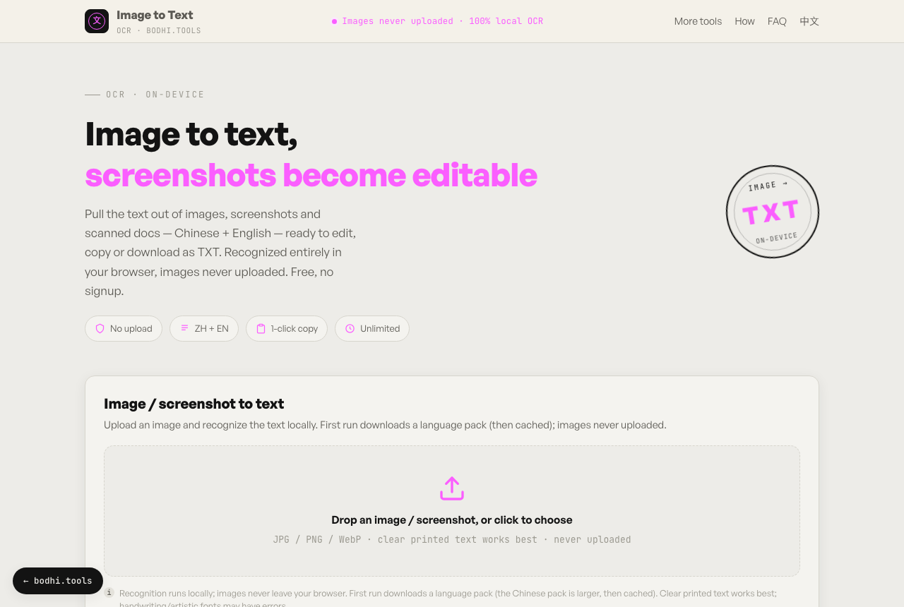

# 图片转文字（OCR）

[English](README.md) · **简体中文**

在浏览器里识别图片、截图和扫描件中的文字，全程不上传。支持简体中文和英文，识别结果可编辑、复制，或保存为 TXT。

**在线使用：** https://ocr.bodhi.tools/



## 功能

- 识别语言：中文 + 英文（默认）、仅英文、仅中文
- 结果可编辑，一键复制，可下载为 `.txt`
- 加载语言包和识别时显示进度
- 清晰、高对比度的印刷体效果最好；手写体和艺术字可能识别出错
- 无需注册、不限次数
- 中英文界面

## 实现原理

[tesseract.js](https://github.com/naptha/tesseract.js) 把 Tesseract OCR 引擎编译成 WebAssembly，在 Web Worker 中运行。首次使用时会下载引擎和所选语言的数据，之后由浏览器缓存。中文语言包比英文大。

## 隐私说明

- 图片只在你的浏览器里读取和识别，应用没有任何上传接口，适合处理含有隐私信息的截图。
- tesseract.js 会从 jsDelivr 下载 worker、WebAssembly 引擎和语言数据；字体从 Google Fonts 和 Fontshare 加载。
- ocr.bodhi.tools 上的线上版本接入了 Cloudflare Web Analytics，只统计页面访问量，不使用 Cookie。自行部署时如不需要，删除 `index.html` 和 `en/index.html` 中的 `cloudflareinsights` 脚本标签即可。

## 本地运行

需要 Node.js 20.19+（或 22.12+）和 [pnpm](https://pnpm.io)。

```bash
git clone https://github.com/bodhi1425/ocr.git
cd ocr
pnpm install
pnpm dev     # http://localhost:5173
pnpm build   # 静态文件输出到 dist/
```

`dist/` 里只有静态文件，可以部署到 Cloudflare Pages、Netlify、GitHub Pages 或任何 Web 服务器。

## 目录结构

```
index.html       中文页 (/)
en/index.html    英文页 (/en/)
src/main.ts      界面与识别逻辑
src/style.css    样式
public/          favicon、robots.txt、sitemap.xml
```

## 依赖

| 包 | 用途 | 许可证 |
|---|---|---|
| [tesseract.js](https://github.com/naptha/tesseract.js) | OCR 引擎 | Apache-2.0 |
| [Vite](https://vite.dev)、[TypeScript](https://www.typescriptlang.org) | 构建 | MIT、Apache-2.0 |

## 更多本地处理工具

以下工具都完全在浏览器中运行：

- [local-pdf-toolbox](https://github.com/bodhi1425/local-pdf-toolbox)：PDF 合并、拆分、压缩与格式转换
- [image-compressor](https://github.com/bodhi1425/image-compressor)：把图片压缩到指定 KB
- [heic-converter](https://github.com/bodhi1425/heic-converter)：iPhone HEIC 照片转 JPG 或 PNG
- [qrcode](https://github.com/bodhi1425/qrcode)：带 logo、渐变、Wi-Fi 和名片的二维码生成器
- [cutout](https://github.com/bodhi1425/cutout)：用本地 AI 模型抠图去背景

## 参与贡献

欢迎提交问题反馈和 Pull Request。较大的改动请先开 issue 讨论。

## 许可证

[MIT](LICENSE) © 2026 bodhi1425
